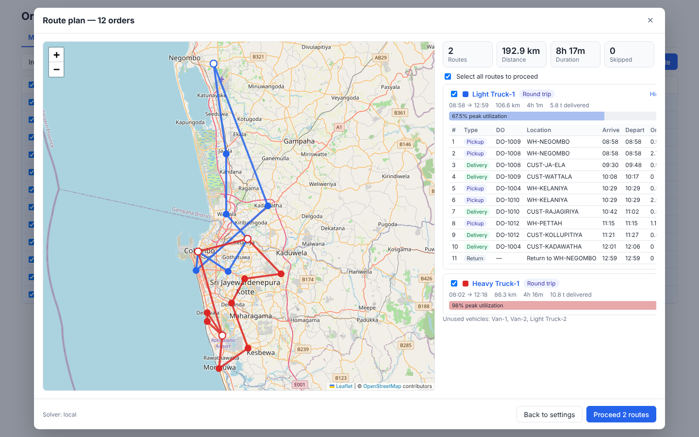

# Multi Pick Route Optimization



A small React + Python (FastAPI) app for the **Multi Pick RO** planning mode: every order has its own pickup and its own delivery, the solver interleaves pickups and drops across trucks, and trucks start at their first pickup.

```text
Import CSV -> save drafts -> select rows -> Plan Route -> POST /orders/route-optimization/preview
          -> map + route list -> Proceed selected routes -> POST /orders/route-optimization/shipment-planning
```

## Run it

```bash
# backend (http://localhost:8000, docs at /docs)
cd backend
python3 -m venv .venv && .venv/bin/pip install -r requirements.txt
.venv/bin/uvicorn app.main:app --reload --port 8000

# frontend (http://localhost:5173, proxies /api -> :8000)
cd frontend
npm install
npm run dev
```

Load `frontend/public/sample-multi-pick-ro.csv` with **Import CSV** (also downloadable from the **Template** button).

Tests: `cd backend && .venv/bin/python -m pytest`

## Solvers

| `RO_SOLVER` | Behaviour |
| --- | --- |
| `auto` (default) | Google if `GOOGLE_ROUTE_OPTIMIZATION_PROJECT_ID` is set, else local |
| `google` | Google Route Optimization `optimizeTours` (requires the env vars below) |
| `local` | OR-Tools pickup-and-delivery model, for offline/dev use |

Google settings:

- `GOOGLE_ROUTE_OPTIMIZATION_PROJECT_ID`: GCP project with the Route Optimization API enabled
- `GOOGLE_APPLICATION_CREDENTIALS`: service-account JSON path (otherwise Application Default Credentials). Keep the key in `backend/secrets/`, which is gitignored:

```bash
cd backend
GOOGLE_ROUTE_OPTIMIZATION_PROJECT_ID=afi-labs \
GOOGLE_APPLICATION_CREDENTIALS=secrets/google-service-account.json \
.venv/bin/uvicorn app.main:app --port 8000
```

The local solver uses straight-line distance × 1.3 at 35 km/h (`LOCAL_SOLVER_ROAD_FACTOR`, `LOCAL_SOLVER_SPEED_KMH`), so its polylines are straight segments and the traffic, toll and highway flags have no effect. Use Google for real road routing.

Other env vars: `RO_DB_PATH` (SQLite file), `API_TOKEN` (when set, requests need `Authorization: Bearer <token>`; give the frontend `VITE_API_TOKEN`), `CORS_ORIGINS`.

## CSV columns

`DO Number, Weight, Volume, Pickup Location Code, Pickup Location Coordinates, Delivery Location Code, Delivery Location Coordinates, Priority, Pickup Open Time, Pickup Close Time, Delivery Open Time, Delivery Close Time`

- Headers are matched case-insensitively. Separate `... Latitude` / `... Longitude` columns also work.
- A generic file with only `Location Code` / `Location Coordinates` copies that location onto both pickup and delivery.
- Coordinates are `"lat, lng"`. Times are `HH:MM` on the plan date.
- Weight is in tonnes and volume in m³. Amounts sent to the solver are weight × 1000 and volume × 100.
- Priority is `High`/`Medium`/`Low` or `1` (highest) to `3`. Higher priority means a higher skip penalty and an earlier place in the capacity pre-check.

## Rules implemented (from the spec)

- Preview sends `pickupLocationId` = empty GUID, `multiPickup: true` and `deliveryAsLastDestination: false`. The backend rejects anything else (Single Pick is not part of this build).
- Every shipment gets both a pickup and a delivery visit. Vehicles omit their start location.
- Load dimension comes from the rows: weight if any row has weight, volume otherwise. A plan that mixes the two is rejected with "All route optimization rows must use the same load type".
- Vehicle types need capacity > 0 for that dimension. Unloading time must be > 0. You need at least one vehicle and at least one row.
- The capacity pre-check skips rows larger than every selected vehicle, and rows that would push the total past the fleet's capacity. It does not assign trucks; the solver does.
- Delivery duration = `unloadingMinutes × demand × 60` seconds.
- **Deliver heavy orders first**: `loadCostFactor` 1 adds a soft-end time at shift start with `costPerHourAfterSoftEndTime = demand × factor`.
- **Minimize vehicle count** sets `fixedCost` = 1,000,000 per vehicle. The other options leave it off. `costPerKilometer` is always 1.
- Shortest distance maps to `avoidHighways`, and Avoid toll maps to `avoidTolls`.
- Vehicles are labelled `{VehicleTypeName}-{n}`.
- **Enable round trip**: after the main solve, each route gets a second solve from its last delivery back to its first pickup. If that fails with traffic on, it is retried once with traffic off. The return is appended as a pickup visit, polylines are merged, and its duration and distance are added. When the solve can't be done, a warning says the truck ends at the last delivery.
- Google deadline code `910` is reported as a warning.
- Draft search filters on `is_multi_pickup`. Proceeding saves a shipment-planning record and marks the drafts it used as proceeded, so they drop out of the list.

## API

| Method | Path | |
| --- | --- | --- |
| GET | `/vehicle-types` | list (seeded: Van 1.5 t, Light Truck 4 t, Heavy Truck 10 t) |
| POST | `/vehicle-types` | create |
| POST | `/orders/route-optimization/drafts` | save imported rows (`isMultiPickup`) |
| POST | `/orders/route-optimization/drafts/search` | rows for the tab |
| POST | `/orders/route-optimization/drafts/delete` | soft-delete |
| POST | `/orders/route-optimization/preview` | solve, writes nothing (400 + `validationErrors` on bad input) |
| POST | `/orders/route-optimization/shipment-planning` | save the routes you proceed with |
| GET | `/orders/route-optimization/shipment-planning` | list saved plans |

## Layout

```text
backend/app/
  main.py            FastAPI routes
  preview.py         preview handler (validation, load dimension, shipments, vehicles, round trip, mapping)
  capacity.py        capacity pre-check
  load_units.py      weight x1000 / volume x100
  db.py              SQLite: drafts, vehicle types, shipment plans
  solvers/google.py  Google optimizeTours adapter
  solvers/local.py   OR-Tools fallback
frontend/src/
  App.tsx                         Orders page (Multi Pick RO tab)
  orderImportUtils.ts             CSV header mapping
  components/ImportModal.tsx      CSV import
  components/ShipmentConfiguration.tsx  plan form
  components/ShipmentPlanModal.tsx      preview request + results host
  components/RouteOptimizationResults.tsx / RouteOptimizationMap.tsx
```

## Simplifications vs. the full spec

- No customer, organization or branch validation, and no location master. Coordinates come straight from the CSV, and rows with missing coordinates are skipped with a reason instead of being geocoded.
- Times are wall-clock on the plan date and are sent to Google as UTC.
